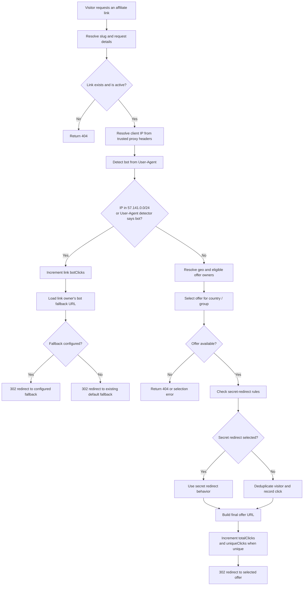

# Affiliate redirect flow

This diagram describes the three affiliate-link redirect handlers:

- `src/app/[slug]/route.ts`
- `src/app/redirect/[slug]/route.ts`
- `src/app/api/redirect/[slug]/route.ts`

## IP rule

The permanent application-level rule matches IPv4 addresses from
`57.141.0.0` through `57.141.0.255` (`57.141.0.0/24`). A match follows the
same bot-fallback branch and increments the link's bot-click counter; it does
not create a regular click record or continue to offer selection.

The rule is applied only by the three affiliate redirect handlers above. It
does not affect landing pages, short URLs, or other routes. It is a redirect
to the configured/default fallback, not a network-level deny.

The handlers resolve the client IP from `cf-connecting-ip`, `true-client-ip`,
`x-real-ip`, then the first `x-forwarded-for` value. These headers must be
overwritten or supplied by a trusted proxy for the range rule to represent the
actual visitor IP.

## Route-specific implementation note

The route implementations share the same decision and outcomes, but their
operation order differs slightly. `/api/redirect/[slug]` checks the IP rule
before geo and offer lookup. `/[slug]` and `/redirect/[slug]` currently start
geo and eligible-owner lookups alongside bot detection before evaluating the
IP rule; they still exit to the fallback before selecting an offer or recording
a regular click.